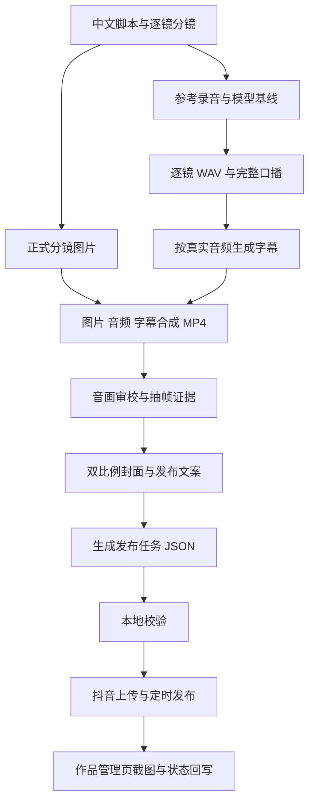

# 中文考研视频流水线

一套可恢复的中文学习视频生产流程：从中文脚本、参考录音和分镜素材开始，经过 GPT-SoVITS 配音、字幕与视频合成、音画审校，最后生成抖音定时发布任务和作品管理页验收凭证。

## 适用范围

- 中文脚本、中文配音、中文字幕和中文话题
- Windows 本地 GPT-SoVITS WebUI
- 已登录的抖音创作者中心
- 可暂停、恢复和复核的单期生产流程

抖音页面仍需要在用户已登录的创作者中心中操作。本包不绕过登录、验证码、权限或平台审核。

## 工作流总览



## 快速开始

在本目录执行：

```powershell
Copy-Item templates\publish-task.json .\第NN期_发布任务.json

.\scripts\prepare_episode.ps1 `
  -Episode 37 `
  -EpisodeFolder 'D:\项目\37_主题_2026-11-18' `
  -Title '隔天就忘，复习到底怎么排才落地？' `
  -Video 'D:\项目\06_视频成品\2026-11-18\第37期_主题.mp4' `
  -CoverHorizontal 'D:\项目\06_视频成品\2026-11-18\第37期_封面_4比3.png' `
  -CoverVertical 'D:\项目\06_视频成品\2026-11-18\第37期_封面_3比4.png' `
  -ReviewJson 'D:\项目\04_审校记录\全中文密集版\第37期_成片复核.json' `
  -CopyFile 'D:\项目\06_视频成品\2026-11-18\06_发布文案.txt' `
  -ScheduledAt '2026-11-18 14:30' `
  -Hashtags '考研,考研备考,间隔复习,老兔学长' `
  -OutputDir 'D:\项目\07_抖音发布'

.\scripts\validate_episode.ps1 `
  -TaskJson 'D:\项目\07_抖音发布\第37期_发布任务.json'
```

`-Title` 是必填参数，不能省略。

## 每期必须保留的文件

```text
第NN期/
├─ 脚本/                       # 全中文脚本与逐镜分镜稿
├─ 音频/
│  ├─ 第NN期_全中文口播.wav
│  ├─ 分镜配音/01_分镜.wav
│  └─ 配音与分镜清单.json
├─ 视频/
│  ├─ 第NN期.mp4
│  └─ 第NN期.srt
├─ 封面/
│  ├─ 第NN期_封面_4比3.png
│  └─ 第NN期_封面_3比4.png
├─ 审校/
│  ├─ 第NN期_成片复核.json
│  ├─ 第NN期_字幕与画面对齐.json
│  └─ 抽帧总览.png
└─ 发布/
   ├─ 第NN期_发布任务.json
   └─ 作品管理页_提交凭证.png
```

## 前期准备清单

1. 安装并验证 GPT-SoVITS，确认 GPT V3 与 SoVITS v2ProPlus 模型配对。
2. 准备全中文脚本、逐镜分镜稿和有权使用的参考录音。
3. 准备正式分镜图，按 scene 顺序命名。
4. 生成逐镜 WAV、完整口播和配音清单。
5. 用实际音频边界生成字幕，再合成视频。
6. 完成音画审校，保存 JSON 和抽帧证据。
7. 准备横竖封面、中文正文和至少三个中文话题。
8. 生成并校验发布任务 JSON，再进入抖音页面。

## 图片和截图示例

本包不伪造平台截图。需要留痕时，建议保存以下三类图片：

- `抽帧总览.png`：展示首帧、中段、尾帧以及字幕位置
- `发布页_双封面与章节.png`：展示双封面、声明和章节设置
- `作品管理页_提交凭证.png`：展示标题、发布时间和平台状态

截图说明模板见 [`docs/SCREENSHOT_GUIDE.md`](docs/SCREENSHOT_GUIDE.md)。

## 详细文档

- [安装与模型基线](references/installation.md)
- [调试与恢复](references/troubleshooting.md)
- [中文脚本与配音](references/dubbing.md)
- [分镜成片与音画审校](references/video-production.md)
- [抖音发布与恢复](references/douyin-publishing.md)
- [逐步执行手册](docs/WORKFLOW.md)
- [截图与图片说明模板](docs/SCREENSHOT_GUIDE.md)

## 验收边界

- 推理程序没有报错，不等于音色已经合格，必须实际试听。
- 本地校验通过，不等于抖音已经发布，最终状态以作品管理页为准。
- `审核中`、`定时发布中` 和 `已发布` 是不同状态。
- 点击发布只做一次；超时后先查作品管理，不重复上传。

## 版本

v1.1：补充完整使用说明、执行手册、截图说明和可复制的发布命令。
